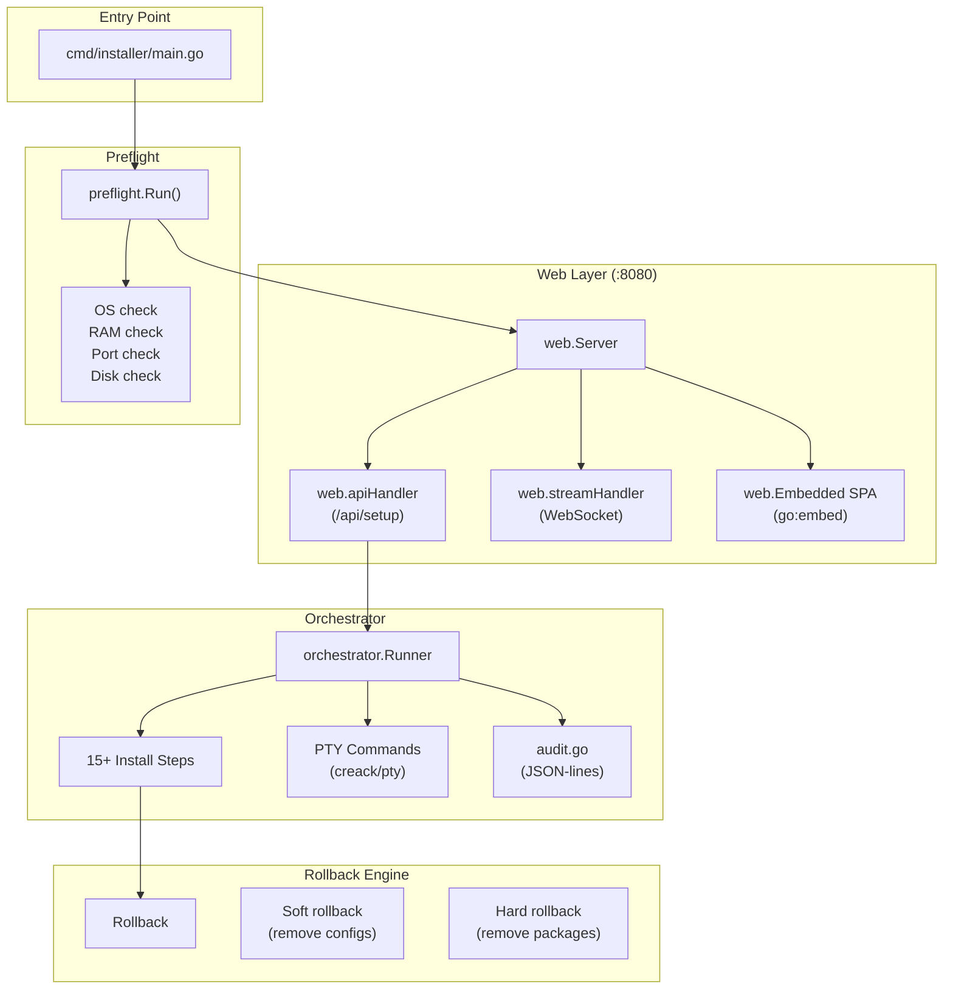

# NOVUS Installer — Архитектура

**Версия:** 0.1.0

---

## 1. Обзор

NOVUS Installer — это самодостаточный Go-бинарник со встроенным веб-интерфейсом (SPA через `go:embed`), который автоматизирует полную установку NOVUS-OS на чистый VPS.

---

## 2. Диаграмма компонентов



---

## 3. Точка входа: `cmd/installer/main.go`

```go
func main() {
    // Флаги
    dev := flag.Bool("dev", false, "Dev mode (skip some checks)")
    dryRun := flag.Bool("dry-run", false, "Dry run (no real changes)")
    
    // Preflight
    preflight.Run()
    
    // Web-сервер на :8080
    server := web.NewServer()
    server.ListenAndServe()
}
```

Режимы запуска:
- **Production:** `sudo ./novus-installer` — полная установка
- **Dev:** `sudo ./novus-installer --dev` — ослабленные проверки
- **Dry-run:** `sudo ./novus-installer --dev --dry-run` — симуляция без изменений

---

## 4. Preflight (`internal/preflight`)

Проверки перед запуском установки:

| Проверка | Критерий |
|----------|----------|
| **ОС** | Ubuntu 22.04/24.04 или Debian 12 (через `/etc/os-release`) |
| **RAM** | Минимум 2 GiB (через `/proc/meminfo`) |
| **Disk** | Минимум 10 GB свободного места на `/` |
| **Порты** | 80, 443, 8080, 9443 не заняты |
| **Root** | Процесс запущен от root или с sudo |
| **Arch** | x86_64 или aarch64 |

---

## 5. Web Layer (`internal/web`)

### HTTP-сервер (`server.go`)
- Порт: 8080
- Статические файлы: встроенный SPA через `go:embed`
- CORS: разрешён только localhost

### API (`api.go`)
- `POST /api/setup` — приём конфигурации установки
- Валидация: email, домен, пароли, сертификаты
- Запуск оркестратора в фоне

### WebSocket Stream (`stream.go`)
- `GET /ws/stream` — live-stream установки
- PTY-вывод в реальном времени
- JSON-сообщения о статусе шагов

### Аутентификация
- Токен в URL: `http://<vps-ip>:8080/?token=<random>`
- После первого запроса — HttpOnly cookie
- Токен генерируется при запуске (crypto/rand, 32 байта)

---

## 6. Orchestrator (`internal/orchestrator`)

### Runner (`runner.go`)

Ядро установки. Содержит:
- **15+ шагов установки** (`buildInstallSteps`)
- **PTY-команды** — выполнение shell-команд с live-выводом
- **Валидацию** — проверка входных данных
- **Генерацию конфигурации** — `.env`, `master.key`, nginx config

### Шаги установки

1. Очистка кэша APT и удаление несовместимых репозиториев
2. Системные зависимости
3. Репозитории PHP 8.5 и MariaDB
4. Установка стека (Nginx, MariaDB, PHP 8.5-FPM, Redis, Supervisor, InfluxDB, Fail2Ban, UFW)
5. Настройка MariaDB (создание БД и пользователей)
6. Установка и настройка сервисов (Redis, Supervisor, Fail2Ban, UFW)
7. Установка novus-agent
8. Конфигурация Nginx и SSL (Let's Encrypt / Cloudflare)
9. Развёртывание кода панели (из приватного репо через GitHub PAT)
10. Настройка Cron-заданий панели
11. Генерация секретов и `.env`
12. Инициализация БД (Bridge Layer)
13. Инициализация схемы БД (System Bootstrap)
14. Настройка администратора (Identity Bootstrap)
15. Настройка локального узла (Agent Node Bootstrap)
16. Интеграции (Telegram, Discord, Google, GitHub)
17. Cloudflare KMS (опционально)
18. Security Entrance (опционально)
19. Восстановление из бекапа (опционально)
20. Очистка и health check

### Audit (`audit.go`)
- JSON-lines лог всех шагов
- Запись в `/var/log/novus-installer/audit.log`
- Ротация при превышении 10 MiB

---

## 7. Rollback Engine

При возникновении ошибки на любом шаге:

### Soft Rollback
- Удаление созданных конфигурационных файлов
- Удаление nginx site configs
- Очистка временных файлов

### Hard Rollback
- `apt-get purge` установленных пакетов (PHP, Nginx, MariaDB)
- Удаление директорий `/var/www/novus`, `/etc/novus`
- Доступен только в `--dev` режиме

---

## 8. Самоуничтожение

После успешной установки бинарник инсталлятора удаляет сам себя:
```go
os.Remove(os.Args[0])
```
Отключается флагами `--dev` или `--dry-run`.

---

## 9. Встроенный фронтенд (`web/`)

- Vue 3 SPA, собирается Vite
- Хранится в `web/dist/`
- Встраивается в бинарник через `go:embed`
- i18n: русский и английский
- Live-stream установки через WebSocket + xterm.js
